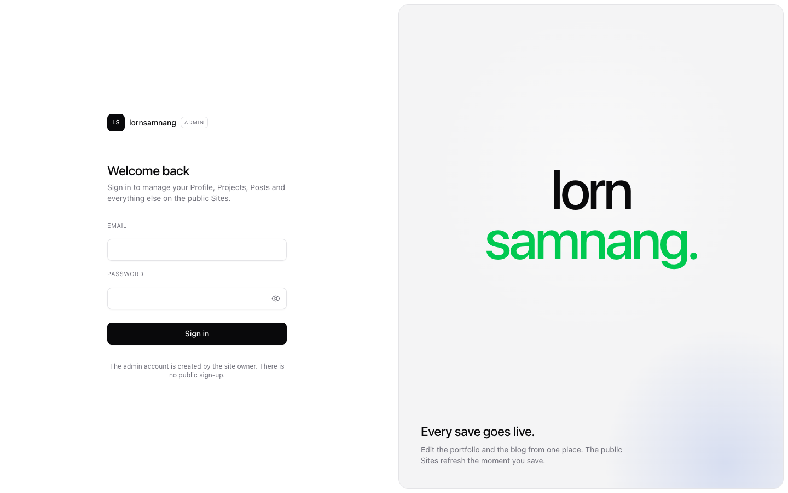
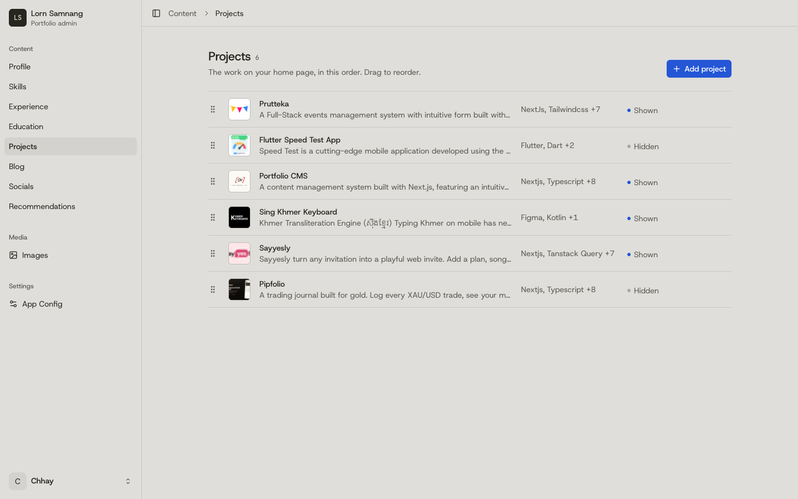
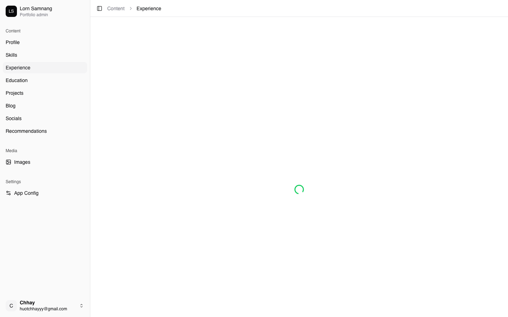
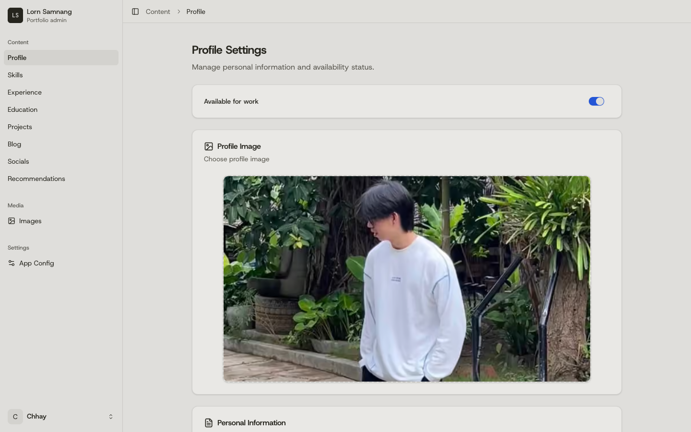
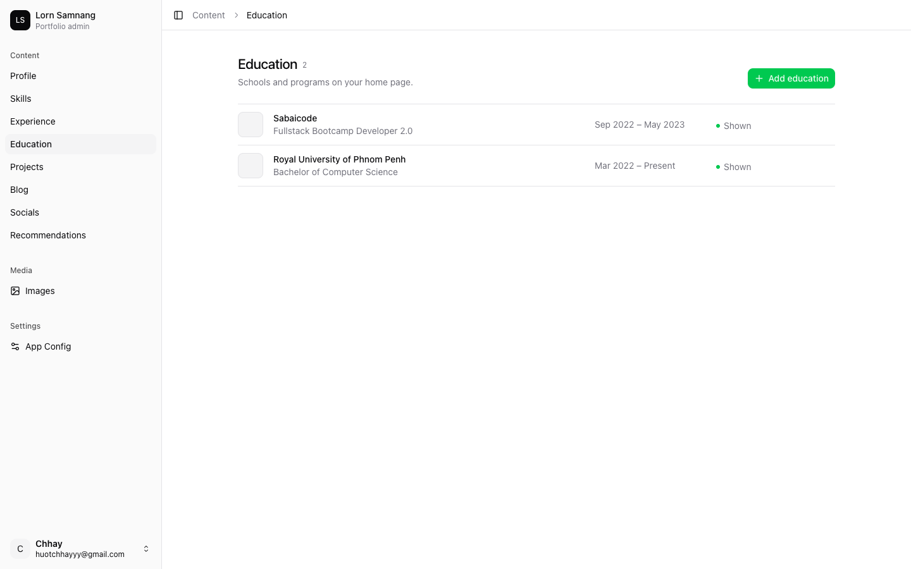
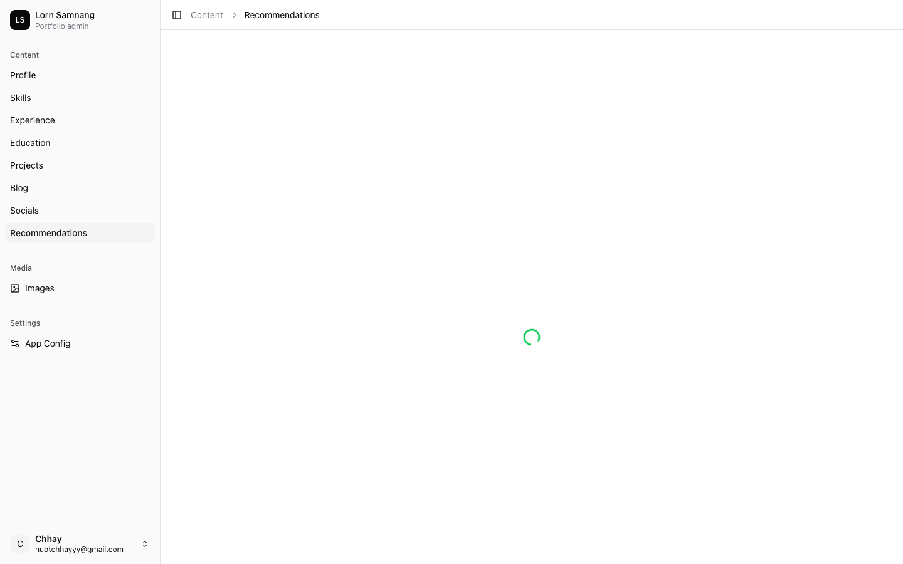
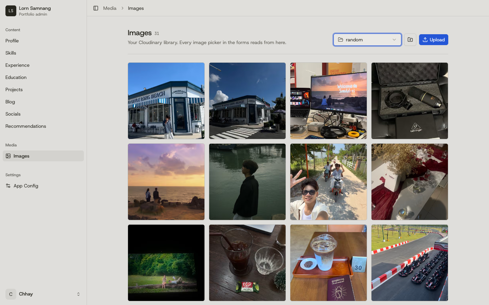
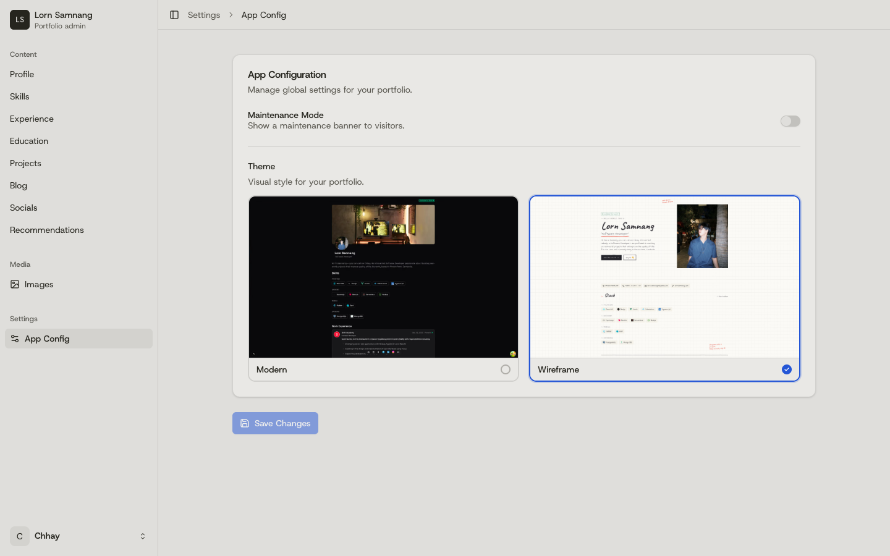

## Portfolio v2

Personal portfolio of [Samnang Lorn](https://github.com/samnanglorn), split into three Next.js Sites that share one database:

| Site | Address | What it is |
| --- | --- | --- |
| **Main** | [lornsamnang.com](https://lornsamnang.com) | The portfolio: profile, experience, projects, achievements |
| **Blog** | [blog.lornsamnang.com](https://blog.lornsamnang.com) | The Post list and each Post |
| **Admin** | admin.lornsamnang.com | The CMS that edits everything above (sign-in only, not indexed) |

The codebase powers this one site and is not intended as a starter kit or template.

## Respect This Work

The design, layout, copy, and code in this repository are original work. Please **do not**:

- Copy the UI/UX, sections, or component structure verbatim
- Repackage any of the design or code for personal/commercial use
- Publish derivatives that could be mistaken for this portfolio

Viewing the source for learning or inspiration is fine—just build something original and credit if you reference ideas. For licensing or collaboration inquiries, reach out before reusing anything substantial.

See the [`LICENSE`](./LICENSE) file for the full legal terms (All Rights Reserved).

## How it fits together

```text
apps/
  main/    Main Site   (public, read-only)   port 3000
  blog/    Blog Site   (public, read-only)   port 3001
  admin/   Admin Site  (sign-in, every write) port 3002
packages/
  db/         Drizzle tables, shared reads, migrations, database roles
  ui/         Primitives and base styles the public Sites share
  wireframe/  The alternate "wireframe" theme and the OG image renderer
```

- **One pnpm workspace**, no Nx or Turborepo. Shared Packages export TypeScript source.
- **Separate database roles.** Main and Blog connect as `portfolio_public`, which can only read the public tables. Admin connects as `portfolio_admin`, which can read and write data but never change the schema.
- **Saves refresh the public Sites.** After a save, the Admin Site calls each public Site's `/api/revalidate` with a shared secret, so changes appear immediately. If a refresh fails, the save still stands and the pages catch up on their own timers.
- **The blog moved.** `lornsamnang.com/blog` and its Posts redirect to the Blog Site.

[`docs/site-split-spec.md`](./docs/site-split-spec.md) has the full design and [`GLOSSARY.md`](./GLOSSARY.md) defines the terms.

## Getting Started

You need Node 24, pnpm 10 and Docker.

```bash
pnpm install
pnpm db:reset
pnpm dev
```

1. `pnpm db:reset` starts a throwaway Postgres in Docker and fills it with made-up content and a local admin account. It recreates the database each time, so anything saved locally is lost.
2. For each Site, copy `apps/<site>/.env.example` to `apps/<site>/.env.local` and fill in the blanks. Use the same `REVALIDATE_SECRET` in all three.
3. `pnpm dev` starts all three Sites. Sign in to the Admin Site at `http://localhost:3002/sign-in` with `admin@lornsamnang.com` / `admin123`.

Every Site refuses to start in development unless `DATABASE_URL` points at `localhost`, so local work never touches production.

| Command | What it does |
| --- | --- |
| `pnpm dev` | All three Sites (`dev:main`, `dev:blog`, `dev:admin` for one) |
| `pnpm build` | Production build of the Main Site (`pnpm --filter @portfolio/blog build`, `... admin build` for the others) |
| `pnpm db:reset` | Recreate the local database |
| `pnpm --filter @portfolio/db db:generate` | Write a migration after changing a table |
| `pnpm --filter @portfolio/db db:roles` | Apply `roles.sql` and check every table's grants |

Schema-change rules, migrations and the production database steps are in [`packages/db/README.md`](./packages/db/README.md).

## Admin Site (CMS)

A password-protected dashboard (Better Auth, sign-up disabled) lets the site owner manage every piece of content shown on the Main and Blog Sites, no redeploy required.

|                                            |                                            |
| ------------------------------------------ | ------------------------------------------ |
| **Sign In**<br> | **Projects**<br> |
| **Experience**<br> | **Profile**<br> |
| **Education**<br> | **Recommendations**<br> |
| **Image Library**<br> | **App Config**<br> |

Content types managed from the CMS:

- **Profile** — availability status and profile photo
- **Skills** — categorized skill entries with logos
- **Experience** — work history with company, role, and period
- **Education** — schools, degrees, and dates
- **Projects** — title, description, tech stack, thumbnail, and active/inactive status
- **Blog** — Posts with a rich-text editor, cover image, category, and draft/published status
- **Socials** — social links with logos
- **Recommendations** — testimonials with reviewer photo and details
- **Images** — a Cloudinary-backed media library (folder-organized) used across all the forms above
- **App Config** — maintenance mode banner and site theme (Modern / Wireframe), applied to the Main and Blog Sites

## Tech Stack

- Next.js 16 App Router with Turbopack, React 19 Server Components
- Tailwind CSS 4, Framer Motion
- Drizzle ORM on Postgres (Neon in production)
- Better Auth (Admin Site only)
- Tiptap rich-text editor (Admin Site only)
- Cloudinary for images
- pnpm workspaces

## Deployment

Each Site is its own Vercel project on the same repository, with its Root Directory set to `apps/main`, `apps/blog` or `apps/admin`. Only the `main` branch deploys: each Site's `vercel.json` turns off deployments for every other branch, so there are no preview deployments.

| Site | Environment variables |
| --- | --- |
| Main | `DATABASE_URL` (`portfolio_public`), `REVALIDATE_SECRET`, `NEXT_PUBLIC_MAIN_URL`, `NEXT_PUBLIC_BLOG_URL` |
| Blog | same as Main |
| Admin | `DATABASE_URL` (`portfolio_admin`), `BETTER_AUTH_URL`, `BETTER_AUTH_SECRET`, `CLOUDINARY_CLOUD_NAME` / `_API_KEY` / `_API_SECRET`, `IMAGE_FOLDER`, `REVALIDATE_SECRET`, `MAIN_SITE_URL`, `BLOG_SITE_URL` |

`REVALIDATE_SECRET` must be the same on all three. Builds never run migrations: they're rehearsed locally and run by hand with the database owner credential, which is never stored in Vercel.
